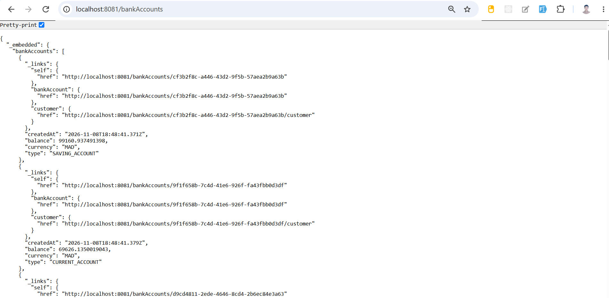
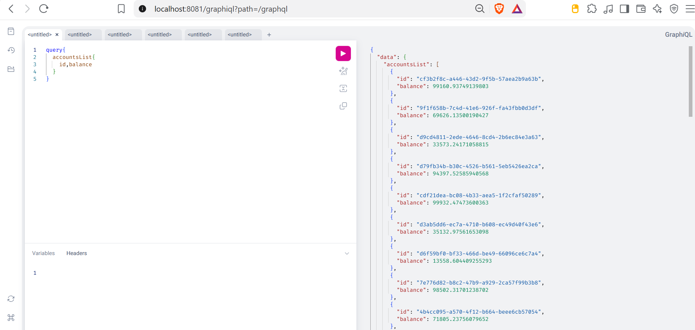
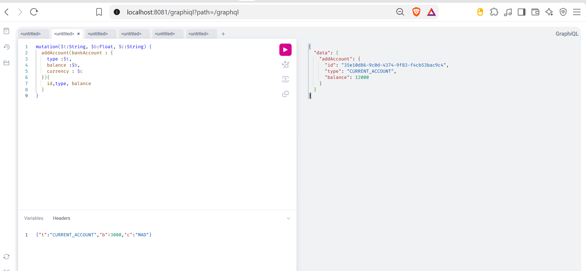
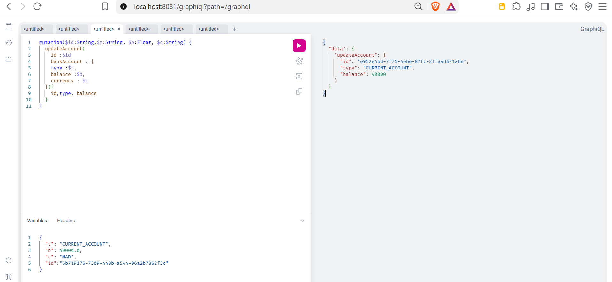
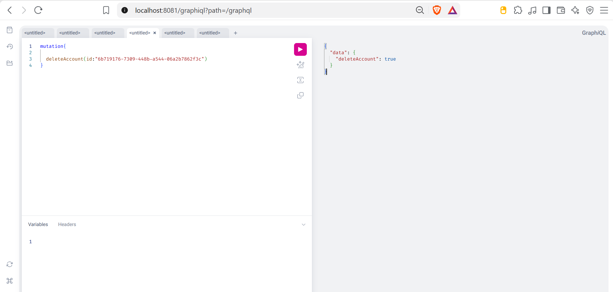
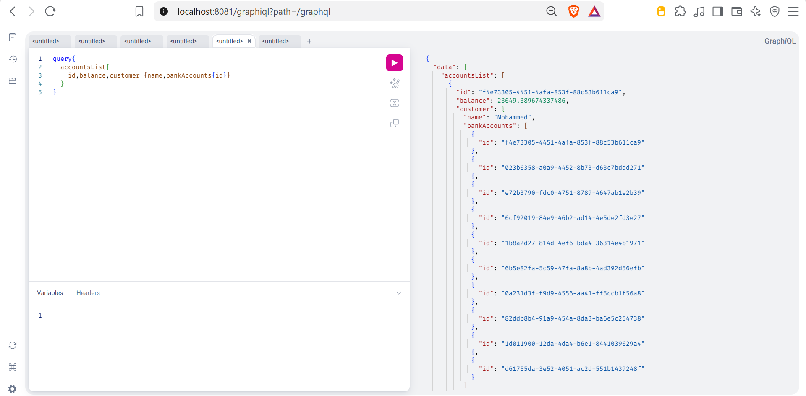
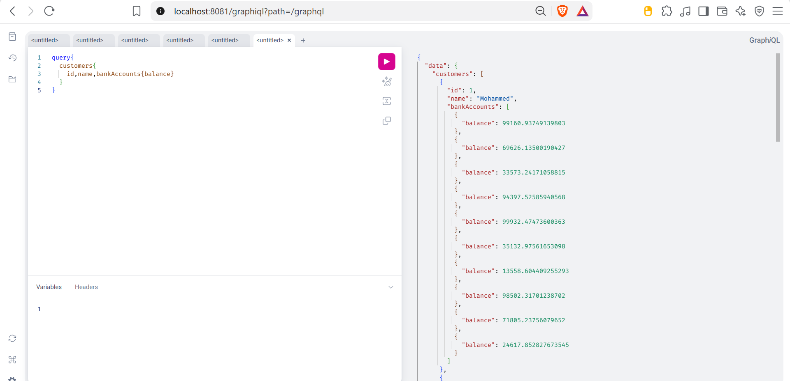

# Bank Account Service

Microservice de gestion de comptes bancaires développé avec **Spring Boot**, **Spring Data JPA**, **Spring Data REST** et **Spring GraphQL**. Ce projet illustre l'implémentation d'une architecture en couches moderne permettant d'exposer des services bancaires à la fois via des APIs **REST** et via **GraphQL**.

## Technologies Utilisées

- **Java 17**
- **Spring Boot** (Spring Data JPA, Spring Web MVC, Spring Data REST, Spring GraphQL)
- **H2 Database** (Base de données relationnelle en mémoire)
- **GraphQL & GraphiQL** (Interface interactive de test GraphQL)
- **Lombok** (Génération automatique de code boilerplate)
- **Springdoc OpenAPI / Swagger UI** (Documentation interactive de l'API REST)
- **Apache Maven** (Gestionnaire de dépendances et de build)

---

## Points d'Accès (Endpoints)

| Service | URL | Description |
| :--- | :--- | :--- |
| **API Spring Data REST** | `http://localhost:8081/bankAccounts` | Accès aux ressources REST HAL |
| **API Custom REST** | `http://localhost:8081/api/bankAccounts` | Contrôleur REST personnalisé |
| **Interface GraphiQL** | `http://localhost:8081/graphiql?path=/graphql` | Console interactive GraphQL |
| **Console H2 Database** | `http://localhost:8081/h2-console` | JDBC URL: `jdbc:h2:mem:account-db` |
| **Documentation Swagger** | `http://localhost:8081/swagger-ui.html` | Interface OpenAPI / Swagger |

---

## Tests et Démonstrations

### 1. API REST (Spring Data REST)

Consultation de la collection des comptes bancaires via Spring Data REST au format HAL / JSON (`GET http://localhost:8081/bankAccounts`) 

---

### 2. API GraphQL (GraphiQL)

L'interface interactive GraphiQL permet de tester les opérations de lecture (*Queries*) et d'écriture (*Mutations*).

#### 2.1. Récupérer la liste des comptes (`accountsList`)
Requête permettant d'obtenir l'identifiant et le solde de chaque compte bancaire :

---

#### 2.2. Ajouter un compte bancaire (`addAccount`)

---

#### 2.3. Mettre à jour un compte bancaire (`updateAccount`)
Mutation permettant de mettre à jour le type, le solde et la devise d'un compte existant

---

#### 2.4. Supprimer un compte bancaire (`deleteAccount`)
Mutation permettant la suppression d'un compte bancaire par son identifiant

---

#### 2.5. Requête imbriquée : Comptes avec client associé (`customer`)
Exemple de puissance de GraphQL avec la navigation dans le graphe : récupérer les comptes bancaires, les informations du client propriétaire et les identifiants de l'ensemble de ses comptes 

---

#### 2.6. Requête clients avec leurs comptes (`customers`)
Consultation de la liste des clients ainsi que les soldes de leurs comptes bancaires associés 

